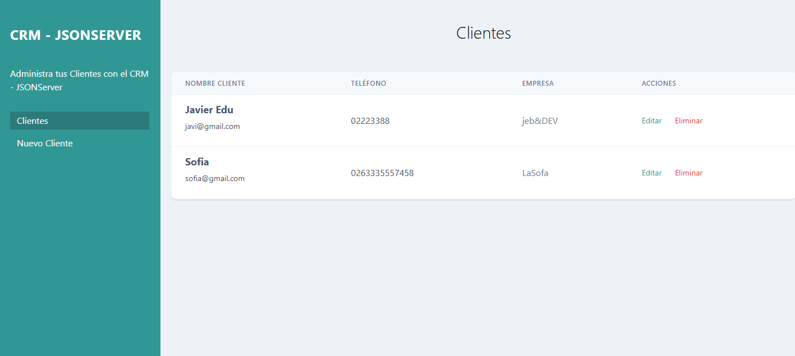
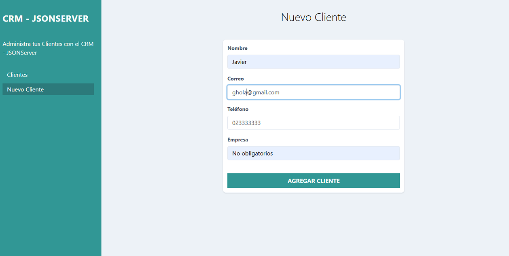
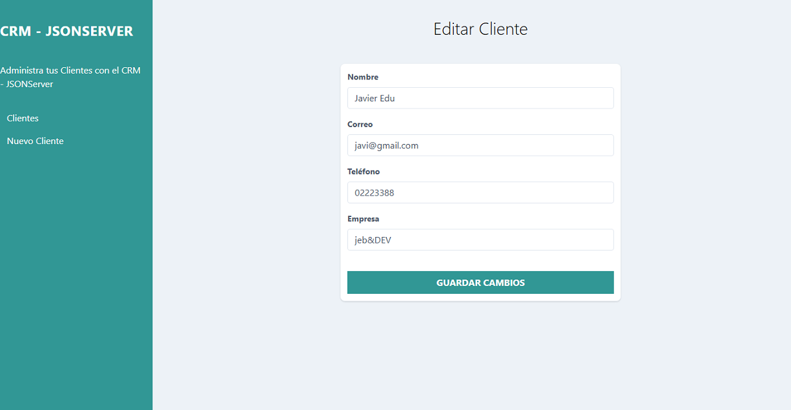

<div align="center">

# 📇 CRM - Gestión de clientes

### Aplicación web CRUD para administrar clientes con JavaScript y JSON Server

<p>
  Una práctica de FrontEnd para crear, consultar, editar y eliminar registros de clientes
  mediante una API REST simulada.
</p>

<p>
  
  
  
  
  
</p>
</div>

---

## 📌 Sobre el proyecto

Este proyecto consiste en un CRM (Customer Relationship Management) para practicar la gestión de clientes desde una interfaz web. Permite mostrar un listado de clientes y realizar operaciones CRUD usando JavaScript y JSON Server como API REST local.

Cada cliente incluye nombre, correo electrónico, teléfono y empresa. La interfaz está construida con HTML y estilos de Tailwind CSS.


## ✨ Funcionalidades

- 📋 Consultar el listado de clientes.
- ➕ Crear clientes desde un formulario.
- ✏️ Editar los datos de un cliente existente.
- 🗑️ Eliminar clientes con confirmación.
- ✅ Validar que los campos estén completos.
- 🔌 Comunicarse con una API REST usando `fetch`.
- 📱 Presentar una interfaz adaptable con clases de Tailwind CSS.

## 🖼️ Capturas de pantalla

<div align="center">

### Listado de clientes



### Crear un cliente



### Editar un cliente



</div>


## 🧰 Tecnologías utilizadas

| Tecnología | Uso |
| --- | --- |
| HTML5 | Estructura de las páginas y formularios |
| CSS / Tailwind CSS | Estilos y diseño adaptable |
| JavaScript (ES Modules) | Lógica, validación e interacción con la interfaz |
| Fetch API | Solicitudes HTTP a la API REST |
| JSON Server | API REST local para simular operaciones con datos |

## 🧠 Lo aprendido

- Organizar una aplicación sencilla en páginas, módulos y responsabilidades.
- Importar y exportar funciones con módulos de JavaScript.
- Seleccionar elementos, escuchar eventos y actualizar el DOM.
- Crear y validar objetos a partir de formularios.
- Realizar solicitudes asíncronas con `fetch` y `async`/`await`.
- Usar métodos HTTP (`GET`, `POST`, `PUT` y `DELETE`) para operaciones CRUD.
- Consultar un registro por su identificador y pasar datos mediante parámetros en la URL.
- Usar JSON Server para practicar el consumo de una API REST.
- Aplicar utilidades de Tailwind CSS para dar estilo a la interfaz.

## ⚙️ Cómo ejecutar el proyecto localmente

### Requisitos

- [Node.js](https://nodejs.org/) y npm.
- Un navegador web.
- Una extensión o servidor local, como **Live Server** para Visual Studio Code.

### Pasos

1. Clona el repositorio y entra en su carpeta:

   ```bash
   git clone https://github.com/TU-USUARIO/TU-REPOSITORIO.git
   cd TU-REPOSITORIO
   ```

2. Inicia JSON Server desde la carpeta del proyecto:

   ```bash
   npx json-server --watch db.json --port 4000
   ```

   La API de clientes estará disponible en `http://localhost:4000/clientes`.

3. Abre `index.html` con Live Server (o con otro servidor estático local) para usar la aplicación.


## 📁 Estructura del proyecto

```text
├── css/
│   └── tailwind.min.css
├── img/
│   ├── crm.PNG
│   ├── crm2.PNG
│   └── crm3.PNG
├── js/
│   ├── API.js
│   ├── app.js
│   ├── editarcliente.js
│   ├── funciones.js
│   └── nuevocliente.js
├── db.json
├── editar-cliente.html
├── index.html
├── nuevo-cliente.html
└── README.md
```
## 👨‍💻 Autor 👑

📞 Contacto
- Para más información sobre el proyecto o servicios de desarrollo web: 

- ## JEB$DEV  de   Javier Berchtold.
- ** -Desarrollador FrontEnd - **

- Mi GitHub [Link GitHub](https://github.com/JEB76-22)
- Mi LinkedIn [Linke In](https://www.linkedin.com/in/javier-berchtold-4270a7182/)
- Mi Correo [Contacto](mailto:j.e.b.inter@gmail.com)


<div align="center">

Hecho con 💻 y muchas ganas de aprender.

</div>
